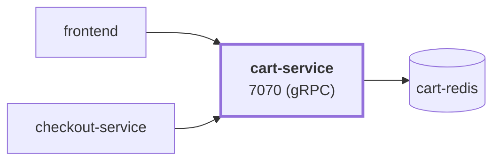

# cart-service

service · platform-demo

A gRPC service that manages shopping carts for the platform-demo e-commerce platform. Carts are stored in Redis keyed by user (session) id. The service itself is stateless, so it can be scaled horizontally; all state lives in `cart-redis`.

Runtime<strong>.NET 10</strong><small>.NET</small>

Listens on<strong>7070</strong><small>gRPC</small>

State<strong>Stateless</strong>

Image<strong>cart-service</strong><small>mladenovskistefan/</small>

## Where it sits

Called by `frontend`, `checkout-service`. It calls `cart-redis`.

## At a glance

| | |
|---|---|
| **Language / runtime** | C# / ASP.NET Core on .NET 10, gRPC (`Grpc.AspNetCore`) |
| **Image** | `mladenovskistefan/cart-service` |
| **Protocol / port** | gRPC (HTTP/2 cleartext) on `7070` |
| **Metrics** | Pushed over OTLP/gRPC (OpenTelemetry .NET) → Alloy → Mimir; no scrape endpoint |
| **Health** | Standard `grpc.health.v1.Health/Check` on `7070` — **reports `NOT_SERVING` when Redis is unreachable** |
| **State** | Redis (`cart-redis:6379`). Service is stateless |
| **Depends on** | Redis (hard runtime dependency); optional OTLP collector |
| **Called by** | `frontend` (all cart operations), `checkout-service` (`GetCart`, `EmptyCart`) |
| **gRPC reflection** | Enabled — `grpcurl` works without `-proto` |

## Find it elsewhere

<h4><a href="https://argocd.platform-demo.click/applications/argocd/dev-cart-service">Argo CD</a></h4>
Sync and health of <code>dev-cart-service</code>.

<h4><a href="https://grafana.platform-demo.click/d/cart-service-overview">Grafana</a></h4>
Latency, traffic and errors (<code>cart-service-overview</code>).

<h4><a href="https://github.com/platform-boutique/app-cart-service">Repository</a></h4>
Source, pull requests and releases of <code>app-cart-service</code>.

!!! info "Part of the platform-demo platform"
    Cross-cutting facts (service wiring, observability contract, Kubernetes translation, CI/CD) are in the
    [master reference](https://github.com/platform-boutique/platform-demo-docs). This site only describes cart-service.
